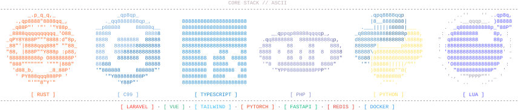

  <picture>
    <source media="(prefers-color-scheme: dark)" srcset="./assets/eye-dark.svg" />
    <source media="(prefers-color-scheme: light)" srcset="./assets/eye-light.svg" />
    
  </picture>

  <strong><a href="https://github.com/Azertyuiop442">@Azertyuiop442</a></strong>
  &nbsp;·&nbsp; <code>Systems &amp; Tooling</code>
  &nbsp;·&nbsp; <code>2nd account</code>
   
  Experimenting across AI optimization, software performance, and systems tooling.

---

<h3 align="center">Featured Builds</h3>

  <a href="https://github.com/Azertyuiop442/Plexus"><strong>Plexus</strong></a> &nbsp;<code>Rust</code> &nbsp;·&nbsp; Modular terminal multiplexer &amp; action dock 
  <a href="https://github.com/Azertyuiop442/deepshrink"><strong>deepshrink</strong></a> &nbsp;<code>TypeScript</code> &nbsp;·&nbsp; Freshness-verified context store for coding agents 
  <a href="https://github.com/Azertyuiop442/cost-tracker"><strong>cost-tracker</strong></a> &nbsp;<code>TypeScript</code> &nbsp;·&nbsp; Token cost, prompt cache &amp; context monitor 
  <a href="https://github.com/Azertyuiop442/ESP32DISCORDBOT"><strong>ESP32DISCORDBOT</strong></a> &nbsp;<code>C99</code> &nbsp;·&nbsp; Bare-metal ESP32 Discord framework (TLS 1.3)

 

  <picture>
    <source media="(prefers-color-scheme: dark)" srcset="./assets/contrib-dark.svg" />
    <source media="(prefers-color-scheme: light)" srcset="./assets/contrib-light.svg" />
    
  </picture>

 

  <picture>
    <source media="(prefers-color-scheme: dark)" srcset="./assets/stack-dark.svg" />
    <source media="(prefers-color-scheme: light)" srcset="./assets/stack-light.svg" />
    
  </picture>

  
    <a href="https://x.com/astra442">𝕏 @astra442</a>
    &nbsp;·&nbsp;
    <a href="https://github.com/Azertyuiop442/plexus-community-mods">plexus-community-mods</a>
    &nbsp;·&nbsp;
    <a href="https://github.com/Azertyuiop442/Factorio-Tools">Factorio-Tools</a>
  

